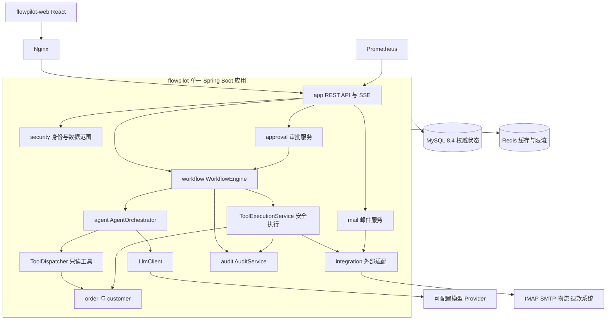
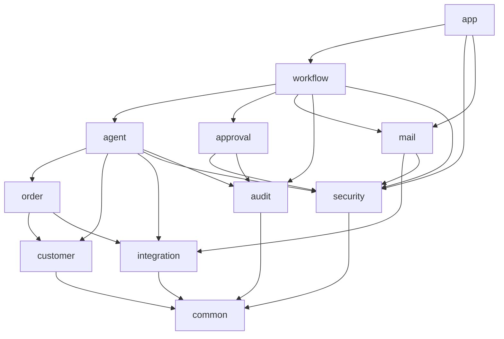
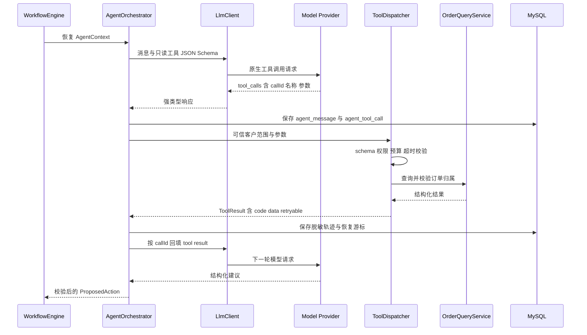
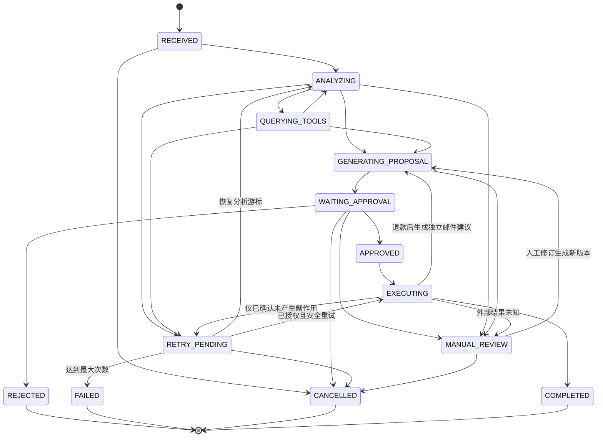
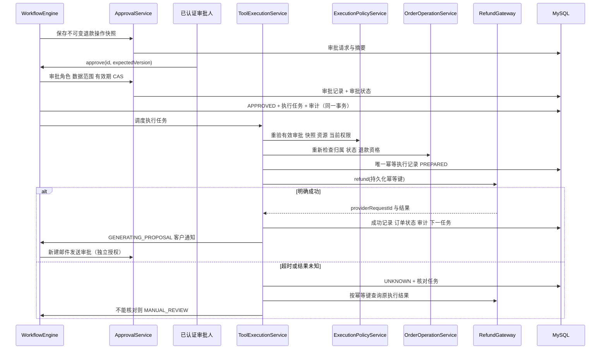

# 第一阶段：架构设计

## 1. 定位、范围与交付状态

FlowPilot 服务于中型企业客服团队，将邮件、订单查询、AI 建议、人工审批、业务执行与审计串成可恢复闭环。采用 React 前端与 Spring Boot 模块化单体，后端只有一个进程和部署单元，不拆微服务。

本文件是待实现的设计契约，所有类与目录均指向后续阶段的具体实现计划；本阶段不声称业务代码、工具调用或部署已经可用。前端根目录为 `flowpilot-web/`，后端根目录为 `flowpilot/`，优先使用用户指定名称。

### 业务角色与验收目标

| 角色 | 允许行为 | 明确限制 |
| --- | --- | --- |
| ADMIN | 用户角色、工作流配置、系统管理 | 管理权限不自动取得客服订单范围与审批权限；需另行分配业务角色 |
| SUPERVISOR | 范围内高风险操作审批、审计 | 不审批自己发起的人工操作，不任意访问其他团队数据 |
| AGENT_OPERATOR | 范围内邮件、订单、一般邮件草稿审核 | 不能审批退款、取消或地址修改 |
| AUDITOR | 范围内工作流、脱敏工具轨迹、审计只读 | 不能分析、审批、重试或执行 |

MVP 先打通订单物流查询、退款申请和独立通知审批，再扩展取消、地址修改、售后与投诉。无法确定身份、意图或业务依据时转 MANUAL_REVIEW。九个工具最终全部提供真实分发、校验与日志；写工具永不注册给模型自动执行器。

生产增强包括双人审批、企业 SSO、多邮件账户、真实支付提供方、供应商签名校验与集中告警。它们不是 MVP 已实现能力；MVP 仍必须满足审批不可绕过、持久化恢复与外部结果核对。

## 2. 技术选型与约束

| 层 | 技术基线 | 选择依据 |
| --- | --- | --- |
| 后端 | Java 21、Spring Boot 3.x、Maven 多模块 | LTS Java；统一事务、安全与部署，控制运维成本 |
| AI | Spring AI、OpenAI-compatible Provider 适配 | 原生工具调用及强类型工具元数据；只选择一个主要 AI 框架 |
| 数据访问 | MyBatis-Plus、Flyway、MySQL 8.4 LTS | 显式查询、乐观锁、可审查迁移，数据库承担业务状态与任务队列 |
| 安全 | Spring Security、JWT、BCrypt | API 与应用服务双层校验、短期凭证和密码散列 |
| 调度 | Spring Scheduling + MySQL 租约任务 | 无需引入消息中间件；支持多个应用副本争抢、宕机恢复 |
| 辅助 | Redis | 限流、短期缓存、JWT 撤销；不作为状态权威 |
| 邮件 | Spring Mail、Jakarta Mail | SMTP 发送、IMAP 拉取；账户凭据外部注入 |
| 前端 | React、TypeScript、Vite、Ant Design | 企业操作台、结构化表单与权限导航 |
| 前端数据 | React Router、Zustand、TanStack Query、Axios | 路由、登录态、服务端数据缓存与 HTTP 分离 |
| 可视化 | ECharts、SSE | 工作台指标与实时执行轨迹 |
| 运维 | Docker Compose、Nginx、Actuator、Micrometer/Prometheus、Logback | 单体部署、健康检查、指标与结构化日志 |
| 测试 | JUnit 5、Mockito、Testcontainers、前端组件及浏览器测试 | 单元策略、真实 MySQL 并发与恢复验证、完整用户流程 |

此处确定技术系列，不虚构已核实的最新补丁版本。阶段三先核实官方 Spring Boot / Spring AI BOM 兼容矩阵并锁定精确版本；阶段六锁定前端依赖和 lockfile。禁止动态版本。数据库测试必须使用 MySQL 8.4，不能以 H2 替代 MySQL 锁、JSON 和索引行为测试。

不引入状态机框架：显式枚举迁移表加事务内 CAS 更新足以覆盖当前状态图，降低隐藏行为。状态、上下文、任务均持久化，禁止用线程休眠表示任务等待。

## 3. 总体架构

前端仅提交用户意图和审批决策，不能提交任意工具名让后端执行。所有资源查询带团队范围；客户身份匹配同时依赖可信接收通道元数据、customer_identity 已验证身份与订单归属，绝不信任邮件正文中的邮箱。直接提交邮件接口仅授权内部角色，开发种子数据不得进入生产。

## 4. Maven 依赖与模块边界

图中箭头表示编译期依赖。所有下层只依赖更低层；模块依赖不能由 Spring 注入形成隐式循环。

每个模块还可直接依赖 common 的通用响应、异常、ID 与时间抽象；common 不含订单、审批或 Agent 业务。app 负责装配所有模块、数据库与部署资源，不承载业务实现。

| 模块 | 核心类 / 接口 | 职责与跨模块边界 |
| --- | --- | --- |
| common | ApiResponse、ErrorCode、BusinessException | 无业务实体的通用契约 |
| security | AuthService、DataScopeService、ExecutionPolicyService | JWT、角色/权限、资源范围、审批执行策略；不依赖工作流实体 |
| customer | CustomerQueryService | 已验证身份、客户归属和脱敏视图 |
| integration | LlmProviderConfig、RefundGateway、LogisticsGateway、MailGateway | 外部超时、幂等与核对接口；真实/Mock 配置隔离 |
| order | OrderQueryService、OrderOperationService | 订单读取、资格检查及业务状态重校验 |
| mail | MailReceiveService、CustomerMailService | 接收去重、可信发件身份、邮件发送及 outbox 状态 |
| agent | AgentOrchestrator、LlmClient、ToolRegistry、ToolDispatcher、ProposalGenerator | 模型循环、只读分发、强类型建议；无审批状态迁移权 |
| approval | ApprovalService、ApprovalPolicyService | 不可变快照、审批资格、过期与并发；不直接执行订单操作 |
| audit | AuditService | 追加审计、脱敏查询、证据链；业务模块禁止修改历史记录 |
| workflow | WorkflowEngine、AgentStateManager、WorkflowRecoveryService、ToolExecutionService | 持久化状态、任务调度、应用级编排和安全执行 |
| app | FlowPilotApplication、SecurityConfig、SseController | 运行装配、HTTP 安全链、运维配置 |

ToolExecutionService 放在 workflow 的 executor 包，不能放在 agent 再反向依赖 workflow/approval。ExecutionPolicyService 只接收不可变授权事实 DTO，由 workflow 组合审批、身份、资源事实；LLM 永远不是权限主体。审批 Controller 在 workflow 的应用入口调用工作流服务，ApprovalService 仅管理审批领域，因此不会发生 approval → workflow 的循环。

跨模块只传 DTO、查询视图或结果接口，不访问其他模块 Mapper。Controller → Service 接口 → ServiceImpl → 本模块 Mapper，实体禁止直接作为 API 响应。前端与后端跨域开发由允许源配置，生产通过 Nginx 同源访问。

## 5. Agent 组件与原生工具调用

| 组件 | 输入、输出与执行顺序 |
| --- | --- |
| WorkflowEngine | 领取持久化任务，驱动分析、审批后执行与完成状态 |
| AgentStateManager | 校验迁移，CAS 更新状态、version、上下文、历史与下一任务 |
| AgentContext | workflowId、客户/团队范围、会话摘要、工具预算、步骤与恢复游标 |
| PromptTemplateManager | 版本化系统提示；邮件、工具结果标为不可信数据，不拼入系统指令 |
| LlmClient | Spring AI 实现发送消息与只读 JSON Schema，返回原生 tool_calls 或结构化最终响应 |
| AgentOrchestrator | 限定轮数/总耗时，持久化请求、返回与游标后处理下一步 |
| ToolRegistry | 注册九工具的名称、schema、权限、读写类型、超时、脱敏规则 |
| ToolDispatcher | 只分发 READ 工具，校验参数与可信上下文中的客户范围 |
| ProposalGenerator | 解析并验证 ProposedAction；不执行副作用 |
| ApprovalService | 固化快照和摘要，记录具体用户的审批结果与期限 |
| ExecutionPolicyService | 校验审批范围、角色、快照摘要、有效期及操作类型 |
| ToolExecutionService | 从有效审批加载快照，重验业务，领取唯一执行记录后执行副作用 |
| AuditService | 记录状态、权限拒绝、工具请求/结果摘要、审批与执行关联 |
| WorkflowRecoveryService | 扫描到期租约、待调度任务与未决外部执行，安全恢复 |

工具清单：getOrderById、getOrderByEmail、getLogisticsInfo、getCustomerInfo、checkRefundEligibility 为 READ；requestRefund、cancelOrder、updateShippingAddress、sendCustomerEmail 为 WRITE。WRITE 元数据仅用于后台审批后分发，不作为模型自动调用的回调。模型如返回未知工具或 WRITE 请求必须拒绝、审计并转人工，不能执行。

ToolResult 统一包含 callId、success、code、data、retryable、durationMs、correlationId。JSON 参数经白名单 DTO 与 Bean Validation 双重校验，不接受模型传入 actorId、teamId 或 approvalId 作为授权事实。预算由服务端配置（默认每轮最多 5 个工具、每工作流最多 20 次、模型最多 8 轮），达到上限转人工。

不记录隐藏思维链；展示模型发出的工具请求、脱敏参数/结果、结构化依据和下一步动作。生产提供真实 Spring AI Provider；测试 FakeLlmClient 返回确定性原生工具响应结构，不以关键字分类冒充真实 Agent。

## 6. 工作流状态与恢复

合法迁移以阶段五代码枚举表为准，以上是其设计契约。任务包含 resumeState 和 stepCursor，重试不能选择任意历史状态；终态不能直接 retry，需新建关联的人工重处理实例。等待超时进入 MANUAL_REVIEW；执行中取消只标记请求，必须先核对外部结果，再由人工处理，禁止伪造“已取消”。

MySQL 持久化 workflow_instance/version、workflow_context、agent_message、workflow_task、workflow_transition_log。领取任务采用短事务的 SKIP LOCKED / 条件更新，持有 leaseOwner、leaseUntil、fencingToken。慢网络调用在事务外进行；回写必须带最新租约令牌与版本，防止旧 worker 覆盖。外部操作另由唯一 operation_execution 行约束，不能只依赖租约。

任务轮询不持有长数据库锁。恢复先检查外部执行状态；只读工具可重放，已提交的结果直接复用，WRITE 绝不因租约到期重复调用。等待审批状态从数据库加载；重启无需重新生成建议。SSE 读取持久化事件，支持 Last-Event-ID 和断线重放；使用 Axios/fetch 流式请求携带 Authorization header，禁止 JWT 放 URL。客户端接到事件后重新查询权威状态。

## 7. 不可变审批与安全执行

ProposedAction：actionType、targetId、parameters、riskLevel、reason、expectedEffect、approvalPolicy、expirationTime、proposalVersion。服务端确定风险与策略，模型只能提出风险建议。金额从订单服务取得，不能信任模型输出金额。

actionType 映射固定执行器；快照含规范化参数与目标资源、申请上下文、版本，计算 SHA-256 摘要。审批只接受 approvalId、expectedVersion、decision、comment，不能接受替换后的 parameters。修改建议生成新版本并使旧审批失效。退款、取消和地址修改在 MVP 都要求 SUPERVISOR；客户邮件由 AGENT_OPERATOR 或具有对应权限的主管审核。人工发起者不能审批自己的操作；自动建议由系统提出、人工授权、系统执行，执行器不是审批用户的会话代理。

事务边界：①接收邮件、唯一 Message-ID、工作流与首任务原子提交；②模型或工具结果、上下文游标、状态事件与下一任务原子提交；③审批记录、审批状态、工作流与执行任务原子提交；④执行预登记原子提交；⑤远端结果确认后，本地订单结果、execution、审计与下一任务原子提交。同一数据源跨模块由 workflow 应用服务开启事务；外部调用不置于数据库事务中。

没有数据库与 SMTP/支付的分布式原子提交。支付适配必须支持幂等与查询，未知结果先核对。普通 SMTP 不保证去重与投递查询：发送记录预登记，超时标 UNKNOWN、人工核对，不自动重发。Provider 明确支持幂等时才按其契约恢复。不能宣称端到端 exactly-once。

## 8. 三条关键业务流程

**查询物流**：可信通道接收邮件 → 校验客户身份 → 模型请求 getOrderById → 工具重验归属 → getLogisticsInfo → 基于实际结果生成回复 → 独立 sendCustomerEmail 审批 → 权限与摘要重验 → 发送 → 审计完成。审批前任何环节都不得发送。

**申请退款**：模型查询订单与 checkRefundEligibility → 保存退款建议与依据 → 主管审批 → 重新校验订单版本、金额和资格 → requestRefund → 已确认成功后创建新的邮件发送建议 → 客服另行审批 → sendCustomerEmail → 完成。拒绝通知不回滚已成功退款；保留退款结果与通知拒绝事实。

**重启恢复**：WAITING_APPROVAL 的快照、请求、上下文与历史已提交 → 服务停止 → 启动恢复扫描仅领取可运行任务 → 客服查询原审批 → CAS 审批后创建执行任务 → 从持久化快照继续。自动化测试必须关闭并重建 Spring 上下文、保留同一个 MySQL 容器，验证不重复查询、退款或生成审批。

## 9. 异常与恢复策略

| 故障 | 分类与动作 |
| --- | --- |
| 模型超时、限流、可恢复服务端错误 | 持久化 RETRY_PENDING，指数退避加抖动；最多 3 次，耗尽 FAILED |
| 无效 JSON、schema 错误 | 最多一次受限格式修复；仍失败 MANUAL_REVIEW，不执行 |
| 工具参数错误、未知工具、非法写工具 | 拒绝、审计；转人工，不盲重试 |
| 订单不存在、归属不匹配 | 泛化响应避免资源枚举；转人工核验，不泄露其他客户记录 |
| 物流不可用 | 只读重试；耗尽记录失败任务，不捏造物流 |
| 数据库不可用 | 不调用外部写操作；事务回滚，恢复后依租约与执行记录检查 |
| 重复邮件 | 账户 + Message-ID 唯一约束；缺 ID 用账户和规范化原文摘要，记录去重原因 |
| 审批过期、并发审批 | 服务端时间判断；版本 CAS 与审批唯一约束，返回冲突，无新执行任务 |
| 第三方写操作明确失败 | 记录 provider code；仅确认未执行且业务允许时重试 |
| 写操作超时实际成功 | UNKNOWN，按原请求键核对；不创建新键或无条件重发 |
| 服务重启 | 租约回收，检查游标和已提交结果，外部写操作先核对 |
| 工具预算超限、业务规则冲突 | MANUAL_REVIEW，保留安全的结构化依据 |
| Prompt Injection | 邮件/工具输出不可信；系统提示隔离只是辅助，实际保障是工具白名单与后端授权 |

退避使用 nextRunAt = now + min(cap, base × 2^attempt) + jitter，调度器查询到期任务；不使用 Thread.sleep。workflow_task 的尝试次数与外部执行次数分别统计。failed_task 保存可追踪错误码、上下文引用、人工接管记录，禁止存密钥与原始敏感正文。Micrometer 输出失败、UNKNOWN、任务积压与租约过期指标，告警部署阶段配置。

## 10. 安全、数据与 API 边界

JWT 仅存主体 ID、过期、jti 等必要信息，服务端查询当前权限，审批与执行时再次检查账号是否启用、权限是否撤销。默认拒绝；API 使用 method security，服务内通过可信 principal 与 DataScopeService 再次验证。线程后台任务没有用户会话，使用审批记录绑定的授权事实与当前账号状态重新校验。

所有 customer_order、mail_message、workflow_instance、approval_request 携带 team_id；关联操作同时校验父子资源范围，阻止通过 tool-call ID、approval ID 和 SSE ID 跨团队读取。只有已验证 customer_identity 可绑定邮件发件人与订单。附件受大小和类型限制，默认不执行或交给模型读取。

数据库规划包含需求全部 28 张表：sys_user、sys_role、sys_permission、sys_user_role、sys_role_permission；customer、customer_identity、customer_order、order_item、order_operation；mail_account、mail_message、mail_attachment、mail_processing_record；agent_session、agent_message、agent_tool_call、agent_proposal；workflow_instance、workflow_transition_log、workflow_task、workflow_context；approval_request、approval_record；audit_log、operation_execution、integration_request_log、failed_task。全量字段、约束、ER、Flyway 和种子 SQL 在阶段二交付。

敏感邮件正文与地址采用应用层加密，邮箱使用规范化 HMAC 检索字段；密钥由部署环境提供并有 keyId 以便轮换。密码 BCrypt；客户/订单 API 返回掩码 VO，按权限提供必要详情。日志只含安全摘要与关联 ID，不记录 JWT、密钥、邮箱原文或完整外部 payload。审计表只追加，数据库服务账号禁删审计；长期防篡改归档作为生产增强。

API 最低覆盖 auth/login、mails 列表/详情/analyze、orders 查询/详情、workflows 列表/详情/events/tool-calls/retry、approvals 列表/approve/reject/return、audit-logs、users/roles。退回修改使旧建议失效并创建新版本，不等于批准。参数校验、统一响应、分页过滤、错误码与 OpenAPI 在阶段二定义、阶段三实现。

## 11. 前端信息架构

| 路由 | 页面与交互 |
| --- | --- |
| /login | 登录、认证错误、过期回登录 |
| /dashboard | 待审批、处理中、失败、时长指标及 ECharts |
| /mails、/mails/:id | 邮件列表、脱敏详情、结构化分析、启动分析 |
| /workflows/:id | 节点状态、时间、输入输出摘要、异常、重试、审批与执行结果 |
| /workflows/:id/tool-calls | 按 callId 查看脱敏参数、结果、耗时及结构化依据 |
| /proposals/:id | 操作快照、风险、依据、订单与历史，提交审核 |
| /approvals | 待办和已处理，批准、拒绝、退回修改 |
| /orders、/orders/:id | 范围内订单搜索与详情 |
| /exceptions | failed_task、UNKNOWN 核对情况、人工接管与安全重试 |
| /audit-logs | 按关联 ID 查询证据链 |
| /admin/users、/admin/roles | 用户启停与角色权限管理 |

前端权限仅用于显示；审批按钮调用真实 API，收到成功后失效 Query 缓存，不本地伪造状态。审批弹窗展示快照版本、目标与参数摘要，409 时强制刷新。Zustand 保存会话与界面状态；订单、审批、工作流以 TanStack Query 为准。SSE 断线退避重连，保留事件游标并补查数据。

## 12. 验收与后续实现

本阶段通过标准：技术路线与单体边界明确、模块无环、目录可创建、九工具的读写权限边界明确、所有状态命名一致、退款和通知双审批、持久化恢复与 UNKNOWN 处理有明确事务边界。

本阶段只运行文档结构检查；构建、集成、端到端、Mermaid 渲染验证尚未进行。后续分阶段实现，不以空方法、占位 Controller 或规则匹配模型替代交付。实际创建的完整目录随实现更新，架构树中的计划文件不代表当前已经存在。
